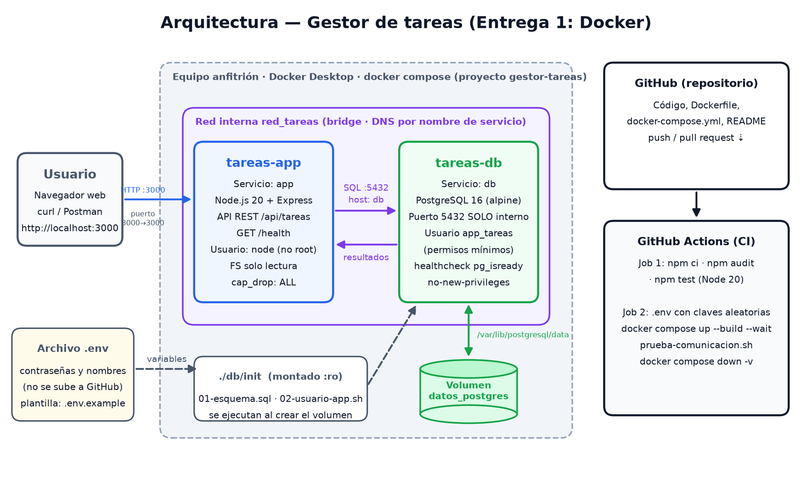

# Gestor de tareas — Integración Continua (Entrega 1: Docker)


Proyecto del módulo **Énfasis Profesional I (Integración Continua)** — Politécnico Grancolombiano.

Aplicación web para gestionar tareas (crear, listar, completar y eliminar) construida con **dos contenedores
Docker que se comunican entre sí**:

| Contenedor   | Servicio | Tecnología                 | Puerto                              |
|--------------|----------|----------------------------|-------------------------------------|
| `tareas-app` | `app`    | Node.js 20 + Express       | `3000` publicado en el equipo       |
| `tareas-db`  | `db`     | PostgreSQL 16 (alpine)     | `5432` **solo dentro de la red**    |

Ambos se conectan a la red `red_tareas`. La app encuentra a la base de datos por el **nombre del servicio**
(`DB_HOST=db`), que Docker resuelve con su DNS interno. Los datos se guardan en el volumen `datos_postgres`.



## Requisitos

- [Docker Desktop](https://www.docker.com/products/docker-desktop/) (incluye Docker Compose v2)
- Git
- (Opcional) Node.js 20 para correr las pruebas unitarias fuera de Docker

## Puesta en marcha

```bash
git clone https://github.com/val132005/gestor-tareas-docker.git
cd gestor-tareas-docker
cp .env.example .env            # luego cambia las contraseñas dentro de .env
docker compose up -d --build    # construye la imagen de la app y levanta los 2 contenedores
docker compose ps               # ambos deben aparecer como (healthy)
```

Abre <http://localhost:3000>. El indicador verde «Conectado a PostgreSQL en "db"» confirma la comunicación.

## Comprobar la comunicación entre contenedores

```bash
bash scripts/prueba-comunicacion.sh
```

El script hace lo siguiente:
1. Consulta `GET /health`: la app ejecuta una consulta en PostgreSQL y devuelve la hora, la base y el usuario.
2. Desde el contenedor `app` resuelve el nombre `db` en la red interna.
3. Crea una tarea por la API.
4. La lee de vuelta por la API.
5. Comprueba que existe directamente en PostgreSQL, consultando dentro del contenedor `db`.
6. Borra la tarea de prueba.

## API

| Método   | Ruta               | Descripción                                    |
|----------|--------------------|------------------------------------------------|
| `GET`    | `/health`          | Estado de la app y de la conexión con la BD    |
| `GET`    | `/api/tareas`      | Lista todas las tareas                         |
| `GET`    | `/api/tareas/:id`  | Obtiene una tarea                              |
| `POST`   | `/api/tareas`      | Crea una tarea `{ "titulo", "descripcion" }`   |
| `PUT`    | `/api/tareas/:id`  | Actualiza `titulo`, `descripcion`, `completada`|
| `DELETE` | `/api/tareas/:id`  | Elimina una tarea                              |

## Buenas prácticas de seguridad aplicadas

- **Secretos fuera del repositorio:** las contraseñas viven en `.env` (ignorado por Git). Solo se versiona `.env.example`.
- **Base de datos no expuesta:** `db` no publica puertos; solo es accesible desde la red interna.
- **Menor privilegio en la BD:** la app usa el usuario `app_tareas`, que solo puede hacer SELECT, INSERT, UPDATE y DELETE sobre `tareas`. No es administrador.
- **Contenedor sin root:** la imagen de la app corre con el usuario `node`.
- **Endurecimiento del contenedor:** `read_only: true`, `cap_drop: ALL` y `no-new-privileges`.
- **Imagen mínima y multi-stage:** `node:20-alpine`, solo dependencias de producción, y `.dockerignore`.
- **Healthchecks** en ambos servicios. La app espera a que la BD esté sana (`depends_on: condition: service_healthy`).
- **Código seguro:** consultas parametrizadas (contra inyección SQL), validación de entradas, `helmet` (cabeceras HTTP), límite del tamaño del cuerpo, errores sin detalles internos y frontend con `textContent` (contra XSS).
- **CI:** `npm audit` de dependencias y contraseñas aleatorias generadas en cada ejecución.

## Integración continua (GitHub Actions)

El workflow [`.github/workflows/ci.yml`](.github/workflows/ci.yml) se ejecuta en cada `push` a `main` y en cada pull request:

1. **Pruebas unitarias:** `npm ci`, `npm audit` y `npm test` con Node 20.
2. **Integración con Docker:** crea un `.env` con contraseñas aleatorias, valida el compose, levanta los contenedores con `--wait`, ejecuta `scripts/prueba-comunicacion.sh` y apaga todo con `docker compose down -v`.

## Comandos útiles

```bash
docker compose logs -f app         # logs de la app
docker compose exec db psql -U admin_tareas -d gestor_tareas -c "SELECT * FROM tareas;"
docker network inspect red_tareas  # ver los dos contenedores en la misma red
docker compose down                # detener (los datos se conservan en el volumen)
docker compose down -v             # detener y BORRAR los datos
```

## Estructura

```
.
├── app/                    # contenedor 1: Node.js + Express
│   ├── Dockerfile
│   ├── public/             # frontend (HTML, CSS, JS)
│   ├── src/                # API, conexión a la BD y validaciones
│   └── test/               # pruebas unitarias (node:test)
├── db/init/                # contenedor 2: scripts de inicio de PostgreSQL
├── scripts/prueba-comunicacion.sh
├── docs/arquitectura.png
├── docker-compose.yml
├── .env.example
└── .github/workflows/ci.yml
```
